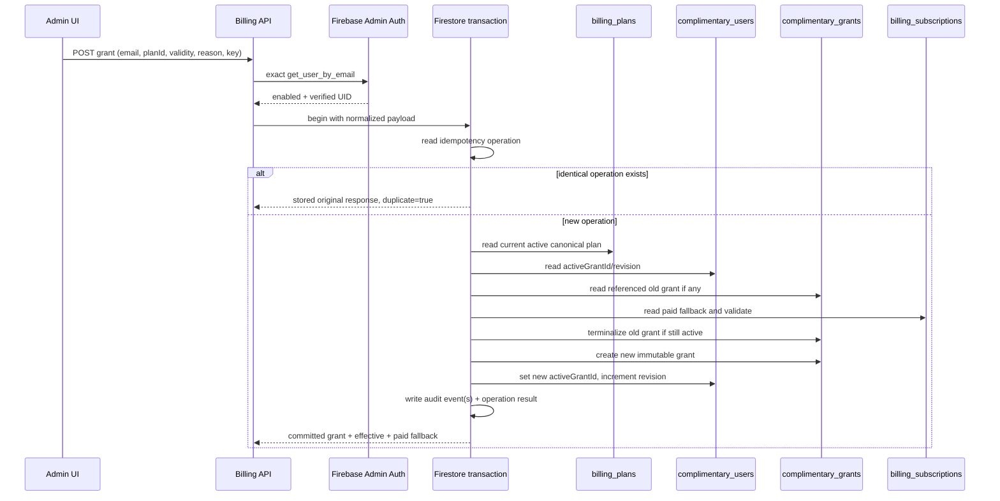

# Design: Administrator-Managed Complimentary Subscriptions

## Overview

This feature extends the existing Firebase-authenticated Flask billing system so an authorized billing administrator can grant and revoke zero-payment access for an existing, enabled, verified Firebase Authentication user. It does not create a second subscription system: paid state remains in `billing_subscriptions`, plans remain in `billing_plans`, administrator identity remains server-derived, and all browser access continues through `billingService` and authenticated `/api/v1` endpoints.

The central design decision is to introduce an auditable complimentary-grant ledger and a single server-side effective-entitlement resolver. The resolver takes the paid subscription, the currently selected complimentary grant, and one authoritative UTC evaluation time. An active complimentary grant wins. When it ends, the paid subscription returns only if its original expiration is still strictly in the future. Paid time is never paused, extended, shortened, refunded, or otherwise changed by a grant.

### Goals

- Reuse the existing Firebase bearer-token, current-session OTP, administrator allowlist/custom-claim, plan catalog, billing error, request-ID, route guard, and visual patterns.
- Allow exact-email lookup of existing Firebase Authentication users without using `users/{uid}` profile data as identity proof.
- Guarantee at most one effective complimentary grant per UID through a per-user transaction serialization document.
- Preserve immutable grant history and transition audit records.
- Keep all Razorpay, coupon, payment, invoice, and revenue behavior unchanged.
- Make frontend and backend premium access decisions consume the same effective entitlement semantics.

### Non-goals

The design does not create users, support bulk operations or fuzzy search, alter the plan catalog, reactivate old grants, hard-delete audit data, modify provider payments, or add a client-writable authorization path.

### Current Behavior and Evidence-Based Gap Analysis

**Confirmed repository behavior:** `backend/billing_api.py` serves `/api/v1/billing/me` from `BillingService.subscription`, and `backend/billing_core.py::subscription_public` derives access only from the paid subscription's finite `expiresAt`. `backend/webhook_intelligence.py` performs a separate paid-only read of `billing_subscriptions` for premium authorization. `src/context/SubscriptionContext.jsx` also requires a finite `expiresAt` to consider access active. `src/components/AdminRoute.jsx` gates only on backend-returned `isAdmin`, while `src/App.jsx` contains Plan Admin and Coupon Admin routes but no complimentary-management route. `firestore.rules` denies existing billing collections to clients, and the repository currently has no complimentary grant, pointer, operation, or audit collection contract.

**Actual defect/gap:** there is no server-owned complimentary entitlement state or administration flow, so an administrator cannot look up an existing Firebase Authentication user, grant or revoke zero-payment access, or have that access resolved consistently by `/billing/me`, backend premium checks, route guards, and user-facing status. Attempting to represent this through the paid record or frontend state would violate the approved payment-preservation and trust boundaries.

**Root-cause assessment:** this is a missing cross-layer capability rather than evidence of one isolated faulty statement. The confirmed paid-only and finite-expiry assumptions above explain the affected surfaces. No runtime reproduction, production data condition, or stack trace is claimed; transaction race outcomes and malformed-record cases remain design-time risks to be verified by the specified tests.

## Architecture

### Existing Architecture and Reuse

| Existing element | Current role | Extension/reuse |
|---|---|---|
| `backend/billing_api.py` | Versioned billing routes, request IDs, strict field allowlists, bearer verification, OTP enforcement, server-derived admin status, sanitized errors | Add complimentary administrator routes under its existing `/api/v1/admin/billing` namespace and extend the same `require_auth` boundary with an optional server-derived capability requirement. These routes require both `admin=True` and `complimentarySubscriptions`; retain `_body`, `_allow_fields`, and the `BillingError` envelope. |
| `backend/billing_core.py` | Plans, public billing shapes, paid billing service, in-memory semantic store | Add validity normalization, public grant shaping, the pure effective-entitlement resolver, complimentary service methods, and matching in-memory transaction semantics. Keep plan/tier normalization centralized here. |
| `backend/billing_store.py` | Admin-SDK Firestore collections and transactions | Add grant, active-pointer, idempotency, and audit collections; extend paid activation transactions to read complimentary state and return the correct effective result. |
| `StoredPlanCatalog` / `billing_plans` | Canonical persisted plan source | Grant requests accept only `planId`; the transaction rereads the active plan and creates a server-owned non-monetary snapshot. |
| `billing_subscriptions/{uid}` | Canonical paid subscription | Remains paid-only and unchanged in meaning. It is read as fallback state; grants never overwrite it. |
| `backend/webhook_intelligence.py` | Existing backend Pro/Elite authorization | Replace its local paid-only Firestore read and duplicated rank map with an injected shared entitlement service. Authentication behavior remains unchanged. |
| `src/services/billingService.js` | Firebase-authenticated billing transport and `BillingApiError` parsing | Add lookup/list/grant/revoke methods; do not add direct Firestore reads. |
| `SubscriptionContext` | Plans, `/billing/me`, admin state, timers, `hasPlan` | Consume additive effective-entitlement fields, support lifetime access, preserve fail-closed behavior, and expose the server-returned `adminCapabilities` state with false/omitted values disabled. |
| `AdminRoute` | Backend-confirmed administrator route gate | Add an optional `requiredCapability` prop; only `/admin/complimentary-subscriptions` requires `complimentarySubscriptions` in addition to `isAdmin`, preserving existing Plan Admin and Coupon Admin behavior. Backend denial still overrides stale frontend state. |
| `Layout` | Responsive navigation and `isAdmin` gating | Add the new admin link adjacent to Plan Admin and Coupon Admin only when backend-confirmed `isAdmin === true` and `adminCapabilities.complimentarySubscriptions === true`. |
| `App.jsx` | Lazy pages and protected nested routes | Lazy-load the new page and wrap it in `ProtectedRoute` through the existing layout and `AdminRoute requiredCapability="complimentarySubscriptions"`. |
| `Subscription`, `Dashboard`, `SubscriptionRoute` | User entitlement display and client route access | Render complimentary/lifetime source correctly and continue using `hasPlan`; no client-side grant proof is introduced. |
| `firestore.rules` | Explicit denial of direct billing collection access | Add explicit deny blocks for all new complimentary collections before the catch-all deny. |
| Existing test suites | Python `unittest`, `MemoryBillingStore`, Flask test client, Node `node:test` service/contracts | Extend these conventions and add emulator-backed transaction and browser E2E coverage where real concurrency or UI interaction is required. |

### High-Level Architecture

```mermaid
flowchart LR
    A[Capability-enabled authorized admin browser] -->|Firebase bearer token + current OTP proof| B[billingService]
    B --> C[/api/v1/admin/billing/*]
    C --> D[Existing auth boundary: admin + server capability]
    D --> E[ComplimentaryBillingService]
    E --> F[Firebase Admin Auth exact-email lookup]
    E --> G[StoredPlanCatalog / billing_plans]
    E --> H[FirestoreBillingStore transactions]

    H --> I[(billing_complimentary_grants)]
    H --> J[(billing_complimentary_users)]
    H --> K[(billing_complimentary_operations)]
    H --> L[(billing_complimentary_audit)]
    H --> M[(billing_subscriptions paid-only)]

    N[Target user /billing/me] --> O[Shared effective-entitlement loader]
    P[Backend premium route] --> O
    Q[Payment activation/webhook] --> O
    O --> M
    O --> J
    O --> I
    O --> R[Deterministic effective entitlement]
```

### Backend component boundaries

1. **Authentication and administration policy** stays in the existing `require_auth` decorator. Extend it with an optional required-capability parameter derived only from server configuration. Every complimentary lookup, list, grant, and revoke endpoint requires a verified/revocation-checked token, current OTP proof, backend-confirmed administrator status, and `complimentarySubscriptions == true` before any target, plan, grant, paid-subscription, or audit read. A false, absent, malformed, or unavailable capability fails closed. No request field can assert administrator status, capability, UID, email verification, or OTP proof.
2. **`ComplimentaryBillingService`** coordinates Firebase Auth lookup, normalization, canonical plan selection, store operations, and public response shaping. It receives the existing clock and Firebase app dependencies for tests.
3. **`EffectiveEntitlementResolver`** is a pure domain function plus a store-backed loader. The pure function contains priority and tier semantics; the loader retrieves and validates the required records.
4. **Store implementations** expose equivalent operations in `MemoryBillingStore` and `FirestoreBillingStore`. Firestore methods own transaction boundaries and reread mutable server state in the transaction.
5. **API handlers** perform transport validation, call services, and append `requestId`; they do not implement entitlement decisions.

## Components and Interfaces

### Administrator API Design

All endpoints use the existing Firebase authenticated fetch path. The complimentary lookup, list, create, and revoke endpoints use the existing `require_auth` boundary extended as `require_auth(admin=True, capability="complimentarySubscriptions")` (or an equivalent optional argument), so token verification, current OTP proof, backend-confirmed administrator status, and the server-derived capability are checked before Firebase target lookup, plan reads, grant reads, paid-subscription reads, audit reads, or Firestore mutation. Capability state comes only from server configuration; false, omitted, malformed, or unavailable state denies the operation, and request bodies/queries cannot enable or override it. Other existing administrator endpoints retain their current `require_auth(admin=True)` behavior. JSON endpoints retain the current 256 KB body limit.

### Common success and error rules

Every success includes a fresh `requestId`. Mutation successes include `duplicate`. Errors retain the current shape:

```json
{
  "error": {
    "code": "stable_machine_code",
    "message": "Safe actionable message",
    "details": { "field": "optional safe detail" }
  },
  "requestId": "server-request-id"
}
```

Unknown fields are rejected with `unexpected_fields`. Internal exceptions are request-correlated in server logs and become a sanitized `billing_unavailable` or a more specific safe availability error. Responses never include bearer tokens, allowlist contents, credential values, raw idempotency keys, stack traces, or another user's unrelated records.

### 4.1 Exact-email lookup

`POST /api/v1/admin/billing/users/lookup`

Request:

```json
{ "email": " person@example.com " }
```

Processing:

1. Require a string, trim surrounding whitespace, enforce a conservative maximum of 254 Unicode code points, reject control characters, and perform case normalization.
2. Call Firebase Admin Authentication `get_user_by_email(normalizedEmail, app=firebase_app)`; never query `users/{uid}` to resolve identity.
3. Require the returned account to have a canonical email. Return account state even when disabled/unverified, but mark `grantEligible: false`.
4. Load the effective entitlement and paid fallback for the returned UID. A malformed billing record fails closed with `billing_data_inconsistent` rather than silently omitting state.
5. Return minimum selection fields. No partial, prefix, domain, list, or bulk operation exists.

Success `200`:

```json
{
  "user": {
    "uid": "firebase-uid",
    "email": "person@example.com",
    "emailVerified": true,
    "displayName": "Person",
    "disabled": false,
    "grantEligible": true
  },
  "effectiveEntitlement": { "status": "inactive", "source": null, "planId": null },
  "paidFallback": null,
  "requestId": "..."
}
```

`uid` is confirmation data, not authorization input for later mutation. Grant creation sends the canonical email; the backend repeats Firebase Admin lookup and derives UID again immediately before the transaction.

Errors include `invalid_email` (400 with `details.field = "email"`), `user_not_found` (404), `target_email_missing` (409 for an inconsistent Auth record), `auth_service_unavailable` (503), and sanitized billing consistency errors. Firebase “user not found” is only disclosed after administrator-and-capability authorization.

### 4.2 Paginated grant list

`GET /api/v1/admin/billing/complimentary-grants?limit=50&email=person%40example.com&planId=pro&status=active&cursor=...`

- `limit`: integer 1–100, default 25.
- `email`: optional exact normalized email snapshot; the endpoint does not resolve partial email.
- `planId`: optional canonical identifier syntax.
- `status`: optional `active`, `expired`, `revoked`, or `superseded`.
- `cursor`: optional opaque, signed, versioned cursor bound to normalized filters and the first page's fixed `asOf` UTC time.
- Unknown query parameters are rejected.

Ordering is always `(createdAt DESC, grantId DESC)`. Status is computed at cursor `asOf`, so expiration does not move records between pages during one pagination walk. The store queries by equality filters and order, scans deterministic batches, computes status server-side, and continues until it fills the requested page or exhausts the query. The cursor records the last scanned `(createdAt, grantId)`, not merely the last returned grant, preventing duplicates or loops when status filtering excludes records. Cursor/filter mismatch, malformed signatures, invalid timestamps, and unsupported versions return `invalid_cursor` (400).

Success `200`:

```json
{
  "grants": ["public administrator grant objects"],
  "page": {
    "limit": 25,
    "nextCursor": null,
    "asOf": "2025-01-01T12:00:00Z"
  },
  "requestId": "..."
}
```

An exhausted query returns `grants: []` and `nextCursor: null`, enabling an explicit frontend empty state.

### 4.3 Create grant

`POST /api/v1/admin/billing/complimentary-grants`

Request fields are exactly:

```json
{
  "targetEmail": "person@example.com",
  "planId": "pro",
  "validity": { "type": "preset", "days": 30 },
  "reason": "Customer support resolution",
  "idempotencyKey": "opaque-client-operation-id"
}
```

Supported validity shapes are mutually exclusive:

```json
{ "type": "preset", "days": 7 }
{ "type": "preset", "days": 30 }
{ "type": "preset", "days": 90 }
{ "type": "preset", "days": 365 }
{ "type": "custom", "expiresAt": "2025-12-31T18:30:00+05:30" }
{ "type": "lifetime" }
```

The server accepts no UID, price, amount, duration outside the four presets, plan name, features, tier, activation time, status, effective source, target state, actor, payment, or audit field. Custom values must be RFC 3339 date-times with an explicit offset, must normalize to finite UTC, and must be strictly later than the final transaction attempt's activation time. Lifetime stores no expiration. Reasons are trimmed, at most 500 Unicode code points, stored as plain text, and reject disallowed control characters and markup delimiters rather than ever being rendered as HTML. Idempotency keys are non-empty opaque strings of bounded length (8–200 characters).

The service repeats exact Firebase Admin lookup using `targetEmail`, rejects disabled (`target_disabled`, 409) or unverified (`target_email_unverified`, 409) accounts, and derives the target UID and canonical email. The transaction rereads the active plan and current paid/grant state.

Success `201`, or `200` for an identical retry:

```json
{
  "grant": { "id": "grant-id", "status": "active", "source": "complimentary" },
  "effectiveEntitlement": { "status": "active", "source": "complimentary", "planId": "pro" },
  "paidFallback": { "status": "active", "source": "paid", "planId": "basic" },
  "duplicate": false,
  "requestId": "..."
}
```

`paidFallback` is `null`, active, or expired as it existed at the commit time and is included in administrator mutation/lookup contexts only. A grant never calls the Razorpay adapter and never writes any order, payment, coupon, invoice, redemption, provider-event, attempt, or analytics document.

### 4.4 Revoke grant

`POST /api/v1/admin/billing/complimentary-grants/{grantId}/revoke`

Request:

```json
{
  "reason": "Access no longer required",
  "idempotencyKey": "opaque-client-operation-id"
}
```

The grant ID must meet a bounded opaque identifier syntax. The transaction verifies that the grant exists, is the UID's current effective active grant at transaction time, and has not expired. It records revocation and immediately resolves paid fallback using the same transaction snapshot.

Success `200`:

```json
{
  "grant": { "id": "grant-id", "status": "revoked" },
  "effectiveEntitlement": { "status": "active", "source": "paid", "planId": "basic" },
  "paidFallback": { "status": "active", "source": "paid", "planId": "basic" },
  "duplicate": false,
  "requestId": "..."
}
```

An identical idempotent retry returns the original committed response with `duplicate: true`. A different key against an ended, expired, or displaced grant returns `grant_state_conflict` (409) and does not mutate it. Unknown grants return `grant_not_found` (404).

### Stable domain errors

| Code | HTTP | Meaning |
|---|---:|---|
| `authentication_required`, `invalid_token`, `token_expired`, `token_revoked` | 401 | Existing token failures. |
| `otp_required`, `admin_required`, `admin_capability_required` | 403 | Existing OTP/admin policy failure or missing/disabled complimentary capability, checked before target, plan, grant, paid-subscription, or audit data access. |
| `invalid_email`, `invalid_plan_id`, `invalid_validity`, `invalid_expiration`, `invalid_reason`, `invalid_idempotency_key`, `invalid_grant_id`, `invalid_limit`, `invalid_filter`, `invalid_cursor`, `unexpected_fields` | 400 | Field-specific contract rejection before mutation. |
| `user_not_found`, `plan_not_found`, `grant_not_found` | 404 | Authorized exact resource was not found. |
| `target_disabled`, `target_email_unverified`, `plan_inactive`, `grant_state_conflict`, `target_state_conflict`, `idempotency_conflict` | 409 | Current authoritative state prevents the requested transition. |
| `billing_data_inconsistent` | 503 | Paid/grant data cannot be safely interpreted; access and mutation fail closed. |
| `auth_service_unavailable`, `persistence_unavailable`, `billing_unavailable` | 503 | Retryable server dependency failure with sanitized details. |

## Data Models

### Persistence Model

All new collections are top-level, Admin-SDK-only billing collections. Grant IDs are random 128-bit-or-stronger opaque identifiers generated by the server. Client input never chooses document IDs or immutable audit fields.

### 5.1 `billing_complimentary_grants/{grantId}`

```text
id                        immutable grant ID (also public object ID)
targetUid                 Firebase Auth UID
targetEmail               canonical Firebase email snapshot
targetEmailNormalized     normalized exact-filter field
targetDisplayName         Firebase display-name snapshot or null
planId                    canonical catalog ID
planSnapshot              {
                            id, name, entitlementTier, features, revision
                          }
validityType              "preset" | "custom" | "lifetime"
presetDays                7 | 30 | 90 | 365 | null
activationAt              authoritative backend UTC
expiresAt                 authoritative UTC for finite grants; null for lifetime
lifetime                  boolean derived consistently from validityType
storedStatus              "active" | "revoked" | "superseded"
createdAt                 same as activationAt for a new grant
updatedAt                 latest transition server time
createdBy                  { uid, email }
reason                     trimmed plain text or null
endedAt                    UTC or null
endReason                  plain text/system reason or null
revokedBy                  { uid, email } or null
supersededByGrantId        grant ID or null
supersededBy               { uid, email } or null
creationOperationId        internal idempotency operation document ID
schemaVersion              integer
```

`status` returned by APIs is computed:

1. `revoked` when `storedStatus == "revoked"`.
2. `superseded` when `storedStatus == "superseded"`.
3. `expired` when otherwise active, finite, and `expiresAt <= evaluationTime`.
4. `active` when otherwise active and either lifetime or `expiresAt > evaluationTime`.

A malformed identity, snapshot, validity, source, status, or audit field is not treated as access. The resolver raises a sanitized consistency error for admin views and returns fail-closed behavior for premium authorization.

The complimentary snapshot deliberately excludes amount, currency, paid duration, payment identifiers, and coupon data. It is generated from the canonical `Plan` record in the transaction and remains unchanged after catalog edits/deactivation.

### 5.2 `billing_complimentary_users/{uid}`

```text
targetUid           UID matching document ID
activeGrantId       current selected grant ID or null
revision            monotonically increasing integer
updatedAt           server UTC
schemaVersion       integer
```

This is the serialization/lookup document, not entitlement proof by itself. The resolver must read and validate the referenced grant. An expired grant may remain referenced until the next mutation; expiration is computed from time and does not require cleanup. Every grant, supersede, revoke, and payment activation transaction reads this document, ensuring per-UID contention is observed.

### 5.3 `billing_complimentary_operations/{operationId}`

`operationId = SHA-256(actorUid + "\0" + operationType + "\0" + idempotencyKey)`. The raw key is never stored.

```text
actorUid             administrator UID
operationType        "grant" | "revoke"
idempotencyKeyHash   SHA-256 of raw key
payloadHash          SHA-256 of canonical normalized payload
status               "committed"
targetUid            target UID
grantId              affected/new grant ID
responseSnapshot     original safe grant/effective/fallback response without requestId
createdAt             commit UTC
schemaVersion         integer
```

The operation document is read first inside the transaction. A matching payload returns `responseSnapshot` and performs no writes. A different payload returns `idempotency_conflict`. Operation documents follow billing audit retention and are not browser-readable.

### 5.4 `billing_complimentary_audit/{eventId}`

Append-only transition records are written in the same transaction as state:

```text
eventId              deterministic unique server ID
eventType            "granted" | "superseded" | "revoked"
grantId              affected grant
targetUid             target UID
actor                 { uid, email } for administrator action
replacementGrantId    new grant for supersession, else null
reason                bounded plain text/system reason or null
occurredAt            transaction UTC
operationId           causal idempotency operation
schemaVersion         integer
```

A new grant writes `granted`; replacing an active grant additionally writes `superseded` for the old grant. Revoke writes `revoked`. Deterministic event IDs and transaction preconditions prevent duplicate events.

### 5.5 Existing `billing_subscriptions/{uid}`

This remains the paid subscription and preserves all current fields and behavior. Complimentary operations only read it. Payment activation continues to update it using existing extension/plan-change rules even while complimentary access is effective.

### Firestore Queries, Indexes, and Rules

### List query and cursor behavior

Base list queries apply zero, one, or both equality filters (`targetEmailNormalized`, `planId`) and order by `createdAt DESC`, then document ID descending. Computed status is evaluated at the cursor's fixed `asOf`. The implementation scans internally until the page is full or the query is exhausted; it never reports an unfiltered loading state as “no records.”

The implementation adds `firestore.indexes.json` (and deployment wiring if the repository still lacks it) with composite indexes for `billing_complimentary_grants`:

1. `targetEmailNormalized ASC, createdAt DESC, __name__ DESC`
2. `planId ASC, createdAt DESC, __name__ DESC`
3. `targetEmailNormalized ASC, planId ASC, createdAt DESC, __name__ DESC`

The no-filter order uses Firestore's built-in indexes. `status` is intentionally not indexed because finite active records become expired as time passes without a write; indexing stored status would be incorrect. If production volume later requires denormalized expiry buckets, that is a separate backward-compatible optimization and cannot replace server-time status computation.

### Security rules

`firestore.rules` adds explicit `allow read, write: if false` blocks for:

- `billing_complimentary_grants/{document=**}`
- `billing_complimentary_users/{document=**}`
- `billing_complimentary_operations/{document=**}`
- `billing_complimentary_audit/{document=**}`

The existing explicit denies for paid billing collections and final catch-all remain. Custom claims do not grant direct Firestore access; administrator access always goes through the backend.

### Validity Semantics

A single normalization function validates the discriminated validity object and rejects extra nested fields.

- **Preset:** exactly 7, 30, 90, or 365. `expiresAt = activationAt + timedelta(days=days)`, meaning consecutive 24-hour UTC days, not calendar-midnight arithmetic.
- **Custom:** parse an offset-aware RFC 3339 date-time, normalize to UTC, and require `expiresAt > activationAt` during the final transaction attempt. Date-only, naive, invalid, infinite, or elapsed values fail.
- **Lifetime:** `validityType = "lifetime"`, `lifetime = true`, `expiresAt = null`, and `presetDays = null`. No far-future date or sentinel is persisted or returned as expiration.

The UI may show a preview based on current browser time, explicitly labeled as an estimate. The confirmation displays the selected local date/time and time-zone name. Only the server-returned activation/expiration is authoritative after commit.

## Correctness Properties

### Property 1: Shared Effective-Entitlement Resolver

**Validates: Requirements 10.8**

### Property 2: Pure resolver contract

**Validates: Requirements 10.7**

```text
resolve_effective_entitlement(paidSubscription, complimentaryGrant, now)
    -> { effectiveEntitlement, paidFallback }
```

The resolver contains no network access and uses one supplied aware UTC `now`. A store-backed loader reads `billing_subscriptions/{uid}`, `billing_complimentary_users/{uid}`, and the referenced grant, validates them, then invokes the pure resolver.

Decision table:

| Complimentary state at `now` | Paid expiration at `now` | Effective result |
|---|---|---|
| Active finite or lifetime | Any/absent/malformed | Complimentary, except malformed paid state causes admin mutation consistency failure when preservation cannot be guaranteed. |
| Revoked, superseded, expired, absent | `expiresAt > now` and valid | Paid. |
| Revoked, superseded, expired, absent | Absent or `expiresAt <= now` | Inactive/expired, no premium access. |
| Malformed referenced grant | Any | Fail closed; never fall through silently because corrupt priority state could grant or hide access. |

Paid and complimentary records are evaluated independently. A complimentary grant never changes paid `startsAt`, `expiresAt`, `paymentCount`, plan, or payment identifiers. Comparison at the boundary is strict: `expiresAt == now` is expired.

### Property 3: Canonical public shape

**Validates: Requirements 6.1**

All effective results normalize to a backward-compatible `subscription` object:

```json
{
  "status": "active",
  "planId": "pro",
  "entitlementTier": "pro",
  "startsAt": "2025-01-01T12:00:00Z",
  "activationAt": "2025-01-01T12:00:00Z",
  "expiresAt": null,
  "updatedAt": "2025-01-01T12:00:00Z",
  "source": "complimentary",
  "validityType": "lifetime",
  "lifetime": true,
  "grantId": "grant-id",
  "planName": "Pro",
  "features": ["..."],
  "complimentary": true
}
```

For paid access, existing fields retain their values; additive fields are `source: "paid"`, `validityType: "finite"`, `lifetime: false`, `grantId: null`, and `complimentary: false`. For inactive access, existing `status`, `planId`, and `expiresAt` behavior remains, with additive source fields null/false. Legacy paid documents without `source` are interpreted as paid.

### Property 4: `/api/v1/billing/me`

**Validates: Requirements 13.5**

The endpoint continues returning:

```json
{
  "subscription": {},
  "isAdmin": false,
  "requestId": "..."
}
```

`subscription` becomes the effective shape above. It does not expose administrator reason, actor identity, idempotency data, audit history, or paid fallback. `/billing/me` also returns server-confirmed `isAdmin` and a server-derived `adminCapabilities` object for frontend authorization, for example `{ "complimentarySubscriptions": true }`. The capability is computed only from server configuration, is never accepted from request data, and is true only when enabled for the current backend-confirmed administrator session; false, omitted, malformed, or unavailable values are treated by clients as disabled. Ordinary users receive false or an omitted capability. Existing clients ignore additive fields and continue using status/plan/expiry.

### Property 5: Backend premium authorization

**Validates: Requirements 6.2**

The duplicated paid-only check in `webhook_intelligence.py` is replaced by an injected `require_entitlement(uid, minimumTier, now)` service backed by the same loader/resolver. The tier rank map (`basic`, `pro`, `elite`) has one server definition shared with billing. The existing bearer/OTP checks, route exclusions, 403 `subscription_required`, and 503 fail-closed behavior remain. Future premium backend routes must use the same service rather than reading billing collections directly.

### Property 6: Transaction and Concurrency Design

**Validates: Requirements 16.3**

### Property 7: Grant/supersede transaction

**Validates: Requirements 5.4**



The transaction uses one `activationAt` generated by the backend on each transaction attempt. Reads occur before writes. If Firestore retries due to contention, current plan, paid state, pointer, old grant, and operation state are reread, and validity is revalidated against that attempt's time.

If the prior selected grant is still effective, it is marked `superseded` with `endedAt`, system end reason, replacement ID, and actor. If it is already expired/revoked/superseded, no supersession transition is fabricated; the pointer is simply replaced. The new grant and pointer commit atomically.

### Property 8: Revoke transaction

**Validates: Requirements 8.2**

The transaction reads operation, grant, UID pointer, and paid subscription. It permits transition only when the grant is the pointer's currently effective active grant. It writes terminal revocation fields, clears `activeGrantId`, increments revision, appends audit, stores the idempotent response, and resolves paid fallback from the same snapshots.

### Property 9: Payment activation while a grant exists

**Validates: Requirements 10.6**

The existing payment transaction remains authoritative for orders, coupons, redemptions, payment history, and paid subscription extension. It is extended to read `billing_complimentary_users/{uid}` and the referenced grant before any writes. Its returned `subscription` is resolved from the newly calculated paid subscription plus the transaction's grant snapshot:

- Active grant: payment and paid subscription commit normally, but response/effective source remains complimentary.
- No active grant: response remains paid as today.
- Concurrent grant/revoke: overlapping reads/writes on the per-UID pointer and paid subscription cause Firestore transaction retry, producing a serializable result.

No complimentary code calls provider APIs or modifies payment analytics. Webhook and browser verification continue sharing the existing payment activation path.

### Property 10: Race outcomes

**Validates: Requirements 16.3**

| Race | Serialization invariant |
|---|---|
| Grant vs. grant | Both write the UID pointer; one retries. The later commit supersedes the earlier active grant. Exactly one pointer/effective grant remains. |
| Grant vs. revoke | Both read/write pointer and grant state; one retries. Revoke either ends the then-current grant or receives `grant_state_conflict`; it cannot clear a replacement pointer. |
| Grant vs. payment | Grant reads paid subscription; payment writes it. Payment reads grant pointer; grant writes it. A conflicting order retries, preserving payment and correct priority. |
| Revoke vs. payment | Revoke reads paid subscription; payment writes it. Payment reads pointer; revoke writes it. Final effective result reflects both committed states and current time. |
| Expiration vs. any write | Expiration is a pure time predicate. Each transaction uses one UTC time and revalidates current effective status; no cleanup race is required. |
| Duplicate mutation | Operation document and payload hash are checked in the same transaction, so only the first transition/audit event commits. |

## Error Handling

The common success/error envelope, stable domain error table, authorization-first behavior, field-specific validation failures, consistency failures, sanitized dependency errors, and retry/conflict semantics are defined in **Components and Interfaces** above and apply throughout the architecture.

## 10. Frontend Design

### Route and navigation

- Add lazy page `src/pages/AdminComplimentarySubscriptions.jsx`.
- Add nested route `admin/complimentary-subscriptions` under the existing protected `Layout`, wrapped with `AdminRoute requiredCapability="complimentarySubscriptions"`. Extend `AdminRoute` only with this optional prop so existing Plan Admin and Coupon Admin routes keep their current behavior.
- `SubscriptionContext` exposes `adminCapabilities` from `/billing/me` and normalizes access as enabled only when `isAdmin === true` and `adminCapabilities?.complimentarySubscriptions === true`; false, omitted, malformed, unavailable, or stale values do not grant access.
- Add “Complimentary Subscriptions” adjacent to Plan Admin and Coupon Admin in `Layout` only under that same strict two-part predicate. Existing administrator links continue using their existing `isAdmin` gate.
- Direct URL access waits for `SubscriptionContext` initialization and is denied by `AdminRoute` unless both backend-confirmed signals are true. Every page API call independently enforces the same two-part backend authorization, so client state cannot authorize an operation.
- If a client sends `isAdmin`, `adminCapabilities`, `complimentarySubscriptions`, or equivalent claims in a request body/query, strict field allowlists reject them; the backend never merges client claims into server authorization state.

### Billing service methods

`billingService` adds:

```text
lookupBillingUser(email)
listComplimentaryGrants({ limit, email, planId, status, cursor })
createComplimentaryGrant({ targetEmail, planId, validity, reason, idempotencyKey })
revokeComplimentaryGrant(grantId, { reason, idempotencyKey })
```

The service builds query strings with `URLSearchParams`, omits empty filters, URL-encodes IDs, and uses the existing authenticated request/error parsing. It sends only documented fields.

### Admin page composition

The page uses small local components and pure formatting helpers rather than a parallel global store:

- `UserLookupCard`: exact email form, lookup loading/error, and selected Firebase user confirmation.
- `GrantForm`: active canonical plans from existing `billingService.getPlans()`, feature/tier display, validity selector, custom date-time, reason, and grant button.
- `GrantConfirmationDialog`: explicit summary before mutation.
- `GrantHistoryFilters`: exact email, plan, and status filters; applying filters resets cursor/page state.
- `GrantHistoryTable` plus responsive cards: all required audit fields and explicit empty/loading/error states.
- `RevokeConfirmationDialog`: target email, plan, validity, optional reason, and explicit confirmation.
- Shared helpers: `formatGrantValidity`, `formatLocalTimestampWithZone`, and status/source badge configuration.

### State flow

```mermaid
stateDiagram-v2
    [*] --> LoadingSections
    LoadingSections --> Ready: plans and list independently settle
    LoadingSections --> PartialError: one section fails
    PartialError --> Ready: section-specific retry succeeds

    Ready --> LookingUp: submit exact email
    LookingUp --> TargetSelected: eligible user found
    LookingUp --> LookupError: invalid/not found/dependency error
    TargetSelected --> Ready: lookup email edited; selection cleared
    TargetSelected --> ConfirmingGrant: valid plan + validity
    ConfirmingGrant --> CreatingGrant: explicit confirm
    CreatingGrant --> GrantSuccess: authoritative response
    CreatingGrant --> GrantError: preserve safe inputs and retry key
    GrantSuccess --> Ready: clear target/form, refresh list

    Ready --> ConfirmingRevoke: choose active row
    ConfirmingRevoke --> Revoking: explicit confirm
    Revoking --> RevokeSuccess: authoritative response
    Revoking --> RevokeError: row/action remains retryable
    RevokeSuccess --> Ready: replace row and refresh page
```



Operation state is separate: `plansLoading`, `lookupLoading`, `listLoading`, `creating`, and `revokingGrantId`. Only controls that can duplicate the same operation are disabled. Plans/list first-load failures do not discard the successful section. Retry retains valid inputs where safe.

Editing the lookup input after selection immediately clears `selectedUser`, target UID display, entitlement summary, and any open confirmation. Grant submit is impossible unless the current input exactly matches the selected canonical email and the selected account remains `grantEligible`; the backend revalidates regardless.

Each new mutation creates a cryptographically random client idempotency key once when confirmation is accepted. A retry after timeout reuses that key and unchanged normalized payload. Editing the payload creates a new key. A successful or explicit reset discards it.

### Confirmation and presentation

Grant confirmation includes canonical target email/display name, selected server plan name/tier/features, selected validity, local time-zone indication, estimated finite expiration, current effective entitlement, paid fallback, and the active complimentary state that may be superseded. The server response replaces estimates after success.

History rows show grant ID, UID, target email/name, plan ID/name/tier, validity, activation, expiration or “Lifetime,” computed status, creation/update/end times, creator, transition actor/replacement ID, and reason as React text content only. Revoke appears only for authoritative active rows and always requires confirmation.

### Subscription context and user-facing pages

`SubscriptionContext` changes active calculation to:

```text
status == active AND (lifetime == true OR finite expiresAt > entitlementNow)
```

It never treats a missing expiration as active unless the server explicitly returns complimentary lifetime semantics. The expiry timer is scheduled only for finite active entitlements. On timer fire, focus, or visibility resume, the context silently calls `/billing/me`; retrieval failure remains fail-closed for non-silent initial loads and never infers access from local storage.

`hasPlan` continues to use the effective `entitlementTier` and shared frontend rank constants. `SubscriptionRoute` needs no source-specific authorization path.

- `Subscription` labels active complimentary access as “Complimentary access,” displays plan/tier, and renders finite server expiration with locale/time zone or “Lifetime.” It does not show amount, renewal charge, payment ID, or invoice for the grant. Existing plan purchase controls remain available; purchasing while a grant is active creates paid fallback under normal Razorpay rules.
- `Dashboard` and `Layout` badges use effective source-aware text and avoid calling `new Date(null)` for lifetime.
- `PaymentHistory` remains payment-only; complimentary grants do not appear as zero-value payments.
- Payment success/pending/failure routes retain current provider behavior. A successful payment response may still show payment details while the effective subscription remains complimentary.

## 11. Security and Trust Boundaries

1. **Administrator identity and capability:** administrator status comes only from verified Firebase ID token claims plus startup-captured `BILLING_ADMIN_EMAILS`; current OTP proof is enforced by the existing policy. The `complimentarySubscriptions` capability comes only from server configuration and is evaluated with administrator status at the shared backend authorization boundary. False, omitted, malformed, or unavailable capability state denies complimentary navigation, route access, and every complimentary administration API. Request bodies, queries, headers other than the verified bearer token, and frontend state cannot influence either decision.
2. **Target identity:** only Firebase Admin `get_user_by_email`; grant creation repeats lookup and derives UID. Client-writable profile email is display-only and never consulted.
3. **Plan authority:** only the current persisted canonical plan document. The client supplies `planId` as a selector; all snapshot fields come from the transaction read.
4. **Time authority:** backend aware UTC time; client previews are informational.
5. **Entitlement authority:** server records plus the shared resolver. Frontend context, local storage, query strings, and profile documents are not proof.
6. **Persistence:** all paid and complimentary billing collections are denied to Firebase clients. Admin custom claims do not bypass rules.
7. **Input handling:** strict top-level/nested field allowlists, bounded strings, exact enums, offset-aware timestamps, safe ID syntax, no HTML rendering, and canonical payload hashing.
8. **Output minimization:** ordinary `/billing/me` excludes admin notes/history/fallback; lookup/list/mutations require both backend-confirmed administrator status and the enabled server-derived capability before reads.
9. **Failure mode:** malformed complimentary grant/pointer state denies premium access and mutations rather than falling through to paid access. Malformed paid state blocks paid fallback/restoration and any administrator mutation that must preserve or report that state; it does not override a separately valid active complimentary grant, consistent with the resolver decision table. Dependency failures fail closed. Logs receive request-correlated diagnostics but not bearer tokens or raw secrets.
10. **Razorpay isolation:** no grant path imports/calls provider operations or writes payment-domain collections.

## 12. Migration and Backward Compatibility

- No paid data migration or backfill is required. Existing `billing_subscriptions` documents are interpreted as paid fallback.
- New collections begin empty; users without grants receive the same paid/inactive semantics.
- `/billing/me` retains existing `subscription`, `isAdmin`, and `requestId` keys and existing paid values; the additive `adminCapabilities` object is server-derived, and clients treat its absence as disabled.
- `billing_subscriptions` remains paid-only, preserving analytics and all existing order/payment/coupon code.
- Existing clients that require `expiresAt` continue working for paid users. The frontend supporting lifetime must deploy before lifetime grants are enabled in the admin UI.
- Historical grant snapshots remain stable when plans are edited, reordered, or deactivated.
- Existing administrator allowlist and custom claim behavior is unchanged.
- Account-deletion cleanup must not add these audit collections to client/user recursive deletion. Any future retention/deletion policy requires separate approval.

## 13. Observability and Operations

Structured server logs use `requestId` and include operation name, result code, duplicate flag, latency, actor UID hash, target UID hash, grant ID, plan ID, validity type, and transition type. Logs do not include bearer tokens, raw idempotency keys, reason text, full email, plan features, or environment secrets.

Suggested counters/histograms:

- lookup success/not-found/ineligible/error
- grant committed/duplicate/conflict/failure
- revoke committed/duplicate/conflict/failure
- supersession count
- effective entitlement source (`paid`, `complimentary`, `inactive`) by route category
- resolver consistency failures
- transaction retries/aborts and latency
- grant-list latency/scanned-to-returned ratio
- premium authorization denial/unavailable counts

Audit documents are the durable business trail; logs are operational telemetry and do not replace them. Alerts should trigger on sustained consistency failures, transaction aborts, or auth/persistence availability errors. Revenue dashboards continue reading captured payment records only; optional grant counts must be separately labeled non-monetary metrics.

## Testing Strategy

### Unit/domain tests

Extend `backend/tests/test_billing.py` or focused complimentary modules using `unittest`, `MutableClock`, `MemoryBillingStore`, and the test Razorpay adapter:

- email, reason, idempotency, grant ID, cursor, filter, and all validity normalizers
- exact preset expiration arithmetic and custom UTC normalization
- lifetime null-expiration behavior
- canonical snapshot content and immutability
- public grant/effective response redaction
- all resolver decision-table rows and strict expiration boundary
- malformed grant/pointer state fails closed without silent paid fallback; malformed paid state rejects conversion/administration and paid restoration while a separately valid active complimentary grant retains priority
- no-provider/no-payment side effects for grants

### Property-based tests

Use deterministic generated-input tests within the existing Python test stack (fixed seeds and reported counterexamples) unless a separately pinned property-testing dependency is approved. Named properties:

1. **Resolver determinism:** identical paid/grant/time input yields identical source, tier, status, and validity output.
2. **Complimentary priority:** every structurally valid active grant wins over every structurally valid paid state.
3. **Paid restoration:** after grant end, paid is effective iff `paid.expiresAt > now`.
4. **Preset duration:** for every accepted preset and generated activation, expiration minus activation equals exactly `days * 24h`.
5. **Lifetime invariant:** accepted lifetime grants never contain an expiration and remain active until a terminal transition.
6. **At-most-one invariant:** every generated sequence of grant/supersede/revoke transitions has zero or one effective active grant per UID.
7. **Idempotency invariant:** replaying an identical normalized mutation changes no collection cardinality or state revision; changed payload with the same key never mutates.
8. **Paid preservation:** arbitrary valid complimentary transition sequences leave paid subscription/payment/order snapshots byte-for-byte unchanged.

Each property test links to its requirement IDs in its test name/comment and prints seed plus minimized/first counterexample data on failure.

### API/auth tests

Flask test-client tests mock Firebase token verification and Admin Auth lookup:

- authorized exact lookup only when both backend-confirmed admin status and the server-derived `complimentarySubscriptions` capability are true
- unauthenticated, OTP, non-admin, capability-false, capability-omitted, malformed/unavailable-capability, and disabled-flag rejection before target lookup, plan/grant/paid/audit reads, or mutation
- forged request-body/query `isAdmin`, `adminCapabilities`, and equivalent capability claims rejected and never used as authorization evidence
- unknown, disabled, and unverified users
- client UID/admin/plan attributes/time/status/price fields rejected
- active/inactive plan race and target revalidation
- every success/error envelope and request ID
- sanitized internal errors
- grant/revoke idempotency and conflict
- list filters, stable ordering, cursor/filter binding, empty state
- `/billing/me` server-derived capability true/false/omitted shapes plus paid compatibility, finite grant, lifetime grant, expiration, revoke, and no admin-only leakage

### Firestore emulator concurrency and rules tests

Use Firebase Auth and Firestore emulator infrastructure against `FirestoreBillingStore`, not mocks:

- two simultaneous grants for one UID
- grant vs. revoke
- grant vs. browser payment verification
- grant vs. captured-payment webhook
- revoke vs. payment
- retry after transaction abort
- exactly one active pointer, complete terminal fields, no lost payment/history, and matching resolver output
- direct client reads/writes to every new and existing billing collection denied for ordinary and admin-claim clients
- required composite indexes exercised by all filter combinations

### Frontend tests

Continue `node:test` for `billingService` request shapes, encoding, structured errors, cursor handling, validity/view-model helpers, and context-active helper behavior. Extract pure page reducer/view-model logic so lookup invalidation, operation-specific loading, idempotency-key reuse, lifetime formatting, and row replacement can be tested without mocks.

Browser component/E2E coverage verifies:

- complimentary navigation is visible only for `isAdmin === true` plus `adminCapabilities.complimentarySubscriptions === true`, and remains hidden for every other combination including false/omitted capability
- `AdminRoute requiredCapability="complimentarySubscriptions"` allows the same two-part state, waits for initialization, and denies direct URLs for false/omitted capability without changing existing Plan Admin or Coupon Admin route behavior
- backend 403 for complimentary lookup/list/grant/revoke when capability is false/omitted despite stale or forged frontend admin/capability state
- independent plans/list errors and retries
- exact lookup and invalidation on edit
- canonical plan/tier/features rendering
- all preset/custom/lifetime controls and confirmation content
- loading, empty, success, and actionable error states
- filters, pagination, required list fields, and local time-zone display
- revoke confirmation and paid/inactive restoration result
- finite expiry refresh and lifetime access without a timer-based false expiry

### Preservation and release checks

Run and keep green:

- `npm run test:billing`
- `npm run test:backend`
- relevant frontend and emulator suites
- existing email/password plus current-session OTP and Google sign-in flows, token refresh, account hydration, logout, and server-side OTP enforcement
- existing server-priced Razorpay order creation, coupon validation, signature verification, browser/webhook reconciliation, late capture, pending-order reconciliation, payment history/invoice, and paid-subscription extension tests
- existing Plan Admin and Coupon Admin behavior, subscription timers, premium tier checks, payment success/pending/failure routes, and unrelated application route/guard tests
- `npm run build`

An end-to-end scenario provisions a verified enabled target in Firebase Auth, signs in an OTP-proven backend-confirmed administrator while the server-derived `complimentarySubscriptions` capability is enabled, looks up the exact email, grants an active canonical plan, confirms no payment-domain record was created, refreshes the target's `/billing/me`, enters a protected route, verifies full grant audit listing, revokes, and verifies paid fallback or inactivity.

## 15. Deployment, Rollout, and Rollback

### Rollout sequence

1. Deploy Firestore indexes and explicit security-rule denies first. Rules are safe before collections exist.
2. Deploy backend reader/resolver support and shared premium authorization while grant collections are empty. Verify no-grant paid behavior and metrics.
3. Deploy backend mutation/list/lookup endpoints behind a server-derived capability flag such as `BILLING_COMPLIMENTARY_ADMIN_ENABLED=false`; the shared authorization boundary returns `admin_capability_required` before protected reads while false or unset.
4. Deploy frontend lifetime-aware `SubscriptionContext`, server capability-state handling, and user status rendering before enabling lifetime grant creation.
5. Deploy the admin page/navigation and optional `AdminRoute` capability gate, still disabled because false/omitted capability state fails closed.
6. Enable the backend capability for authorized administrators, verify `/billing/me` exposes the enabled server-derived value only to eligible sessions, run a controlled finite-grant canary, then lifetime and paid-overlap canaries.
7. Monitor resolver consistency, transaction retry, denial, and payment preservation metrics.

No client secret or Firebase Admin configuration is added. Any cursor-signing secret is server-only, independently rotatable with a versioned key ID, and never exposed to Vite.

### Rollback

- Disable or unset the server capability first. Because omitted and false values fail closed, this hides navigation, denies direct route access, and makes every complimentary mutation/list/lookup endpoint return `admin_capability_required` before protected reads, while `/billing/me` and the resolver continue honoring already committed grants.
- Roll back the frontend page independently; user entitlement fields remain additive and compatible.
- Do not roll back the backend below the resolver-capable version while active grants exist, because that would incorrectly remove access. If a full code rollback is unavoidable, first revoke/migrate active grants through the resolver-capable release under an approved operational procedure.
- New collections and audit records are retained. No rollback deletes grants, payment history, or operations.
- If the new resolver is unhealthy, fail closed for premium checks, disable mutations, and repair/roll forward; never copy grants into `billing_subscriptions` as an emergency workaround.

## 16. Requirements Traceability Matrix

| Requirement | Design coverage | Primary verification |
|---|---|---|
| 1. Authorized administration entry point | Server-derived `/billing/me` admin/capability state, strict two-part `Layout` gating, optional `AdminRoute` capability gate, and the same two-part backend authorization before every complimentary endpoint read/operation | Admin/capability permutation tests for navigation/routes; API pre-read 401/403 and forged-claim tests |
| 2. Existing-user lookup by email | Admin Auth exact lookup, normalized exact email, minimum fields, eligibility, selection invalidation, no search endpoint | Lookup API and UI invalidation tests |
| 3. Reuse canonical plan catalog | Active `billing_plans` transaction read, `planId` selector only, immutable non-monetary snapshot | Plan race/snapshot tests |
| 4. Supported validity choices | Discriminated validity schema, exact presets, offset-aware custom UTC, explicit lifetime/null expiry | Unit and preset/lifetime properties |
| 5. Immediate zero-payment activation | Atomic grant/pointer/audit transaction; no provider/payment writes; next resolver read sees grant | Store/API/E2E side-effect tests |
| 6. Correct user-facing subscription status | Additive effective shape, lifetime-aware context, finite timers, source labels, fail-closed retrieval | Context/UI/timer and `/me` tests |
| 7. Administrator grant list/details | Deterministic cursor pagination, exact filters, computed status, complete public admin shape, empty response | Pagination/filter/UI tests |
| 8. Revoke/remove access | Confirmation, atomic terminal fields/audit/pointer clear, retained history, idempotent/conflict outcomes | Revoke API, UI, concurrency tests |
| 9. Paid-to-complimentary conversion | Lookup/mutation paid fallback, paid collections read-only to grants, dual response | Paid preservation and overlap E2E tests |
| 10. Deterministic priority/restoration | One pure shared resolver, strict time comparisons, independent clocks, payment integration | Resolver properties and transition matrix |
| 11. Server-side identity/admin authorization | Existing revoked-token/OTP/admin decorator extended with optional server-only capability enforcement; Firebase Admin target derivation; sanitized pre-read denial; client capability claims rejected | Auth/capability ordering, false/omitted capability, and forged-body tests |
| 12. Firestore/persistence model | Dedicated grant/pointer/operation/audit collections, computed expiry, rules, consistency validation | Emulator transaction/rules tests |
| 13. Backend/frontend API contracts | Four versioned admin endpoints, strict request shapes, idempotency, structured results/errors, billingService reuse | Service and Flask contract tests |
| 14. Input validation/safe errors | Strict allowlists, bounded plain text, exact enums/IDs/cursors, transaction revalidation, sanitized logs/errors | Fuzz/generated validation and error tests |
| 15. Loading/confirmation/success/empty/error states | Independent operation state, confirmation dialogs, authoritative response replacement, section retries | Page reducer and browser tests |
| 16. Idempotency/concurrency/auditability | Operation payload hashes, per-UID pointer, transaction retries, append-only audit, immutable snapshots | Idempotency properties and emulator races |
| 17. Trust boundaries | Server-owned actor/target/plan/time/entitlement; explicit Firestore denies; no client price/status proof | Security API/rules/static bundle tests |
| 18. Preserve existing behavior | Paid-only subscription record unchanged, payment activation extended not replaced, additive `/me`, payment analytics isolation | Existing billing/auth/preservation/build suites |
| 19. Reuse components/shared functions | Explicit reuse of AdminRoute, Layout gating, billingService, SubscriptionContext, plan catalog, auth/error helpers, resolver/tier centralization | Architecture contract/static tests and review |
| 20. End-to-end verification/build quality | Layered unit/property/API/emulator/frontend/preservation/E2E strategy and required release commands | CI release gate and controlled canary |

## 17. Key Design Decisions

1. **Paid state remains paid-only.** A grant never overwrites `billing_subscriptions`; this makes fallback and audit preservation deterministic.
2. **A per-UID pointer serializes entitlement transitions.** Querying for “active” grants alone cannot enforce uniqueness safely under concurrency.
3. **Expiration is computed, not cleanup-dependent.** Lifetime remains null-expiry and finite grants stop access at the next evaluation even if no scheduler runs.
4. **Grant creation repeats Auth lookup.** Displayed UID is not accepted as a mutation authority; only a fresh exact-email Admin Auth result binds target identity.
5. **Status-filter pagination fixes an `asOf`.** This prevents time-driven expiration from reordering records while an administrator traverses pages.
6. **Payment transactions observe complimentary state.** Paid capture remains intact while transaction contention yields a response consistent with complimentary priority.
7. **Rollback disables writers, not readers.** Already granted access remains honored and paid history remains untouched.
